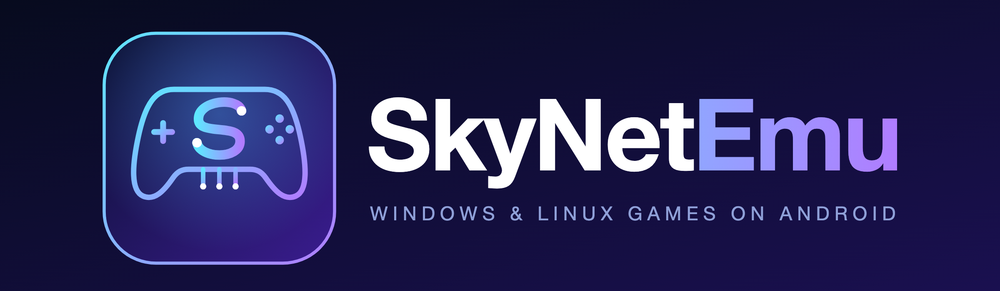

  

  A personal fork of Winlator focused on UX, performance and the features I think Winlator should just have.

---

## What this is

**SkyNetEmu** is a fork of [**Winlator Ludashi**](https://github.com/StevenMXZ/Winlator-Ludashi) by StevenMXZ. Winlator lets you run Windows (x86/x86_64) games and apps on Android through Wine, with `x86_64` containers on Box86/Box64 and `Arm64EC` containers on FEXCore or WowBox64.

I forked Ludashi because I genuinely like it — its UX is the nicest of the Winlator builds I've tried, and it's the base I want to build on. This fork keeps that foundation and adds the UX, performance and functionality changes I consider must-haves, borrowing ideas from the wider Winlator ecosystem where they make sense.

It is **not** a replacement for Ludashi and takes nothing away from it — all credit for the base experience goes upstream. This repo is where I collect the changes I run on my own devices.

## Lineage

This fork stands on a chain of excellent work:

- [**Winlator**](https://github.com/brunodev85/winlator) by brunodev85 — the original.
- [**Winlator Bionic**](https://github.com/Pipetto-crypto/winlator) by Pipetto-crypto — the bionic (native Android libc) base.
- [**Winlator Ludashi**](https://github.com/StevenMXZ/Winlator-Ludashi) by StevenMXZ — the direct parent of this fork.
- Ideas and components also drawn from the [coffincolors fork](https://github.com/coffincolors/winlator) and [GameNative](https://github.com/utkarshdalal/GameNative).

## What's different here

Changes already in this fork, on top of Ludashi:

- **Lossless Scaling frame generation (LSFG).** Integrates the [lsfg-vk](https://github.com/PancakeTAS/lsfg-vk) Vulkan layer (Android port by [FrankBarretta](https://github.com/FrankBarretta/lsfg-vk-android) / [GameNative](https://github.com/GameNative/lsfg-vk-android)) so games get interpolated frames on the GPU. You supply your own `Lossless.dll` from Lossless Scaling — it is never bundled.
  - Configure it per-container under **Video → Frame Generation**: multiplier, flow scale, performance mode, present mode.
  - **Tune it live in-game** from the sidebar's **Rendering** section — switch Off / 2x / 3x / 4x and drag flow scale without leaving the game, so you can A/B the effect instantly.
- **Bulk environment-variable editing.** Edit a container's env vars as plain text — paste a whole block at once instead of adding them one modal at a time.
- **Side-by-side install.** Ships under its own application id, so it installs alongside an existing Ludashi (or other Winlator) build without conflicts and without touching their containers.

More UX, performance and quality-of-life changes are planned — this is an active, personal project.

## Installation

> This is an early personal fork. If there are no prebuilt APKs in [Releases](https://github.com/skynetigor/Winlator-skyNET/releases) yet, build from source (Android SDK + NDK, `./gradlew assembleRelease`).

1. Install the APK. It installs alongside other Winlator builds.
2. Launch it and let the first-run setup unpack the environment.
3. In **Settings → Environments**, install a Wine/Proton runtime, then create a container.

## Useful tips

- **x86_64 container running slow?** Try the **Performance** Box86/Box64 preset in Container Settings → Advanced.
- **Arm64EC container?** Try different FEXCore versions in container settings for the best compatibility/performance.
- **Frame generation:** cap your base frame rate to about half the display refresh (e.g. DXVK Frame Rate 30 for a 60 Hz panel), then let LSFG double it.
- **Old games not opening?** Add `MESA_EXTENSION_MAX_YEAR=2003` in Container Settings → Environment Variables (now easy to paste with the bulk editor).
- **.NET apps:** install Wine Mono from Start Menu → System Tools.
- Use per-game **shortcuts** to give each game its own settings.

## Additional components

- **Winlator components (FEXCore, Box64/Box86, DXVK, etc.):** [StevenMXZ's Winlator-Contents](https://github.com/StevenMXZ/Winlator-Contents)
- **Adreno GPU drivers (Turnip):** [K11MCH1's AdrenoToolsDrivers](https://github.com/K11MCH1/AdrenoToolsDrivers/releases)

## Credits

- **Winlator** by [brunodev85](https://github.com/brunodev85/winlator)
- **Winlator Bionic** by [Pipetto-crypto](https://github.com/Pipetto-crypto/winlator)
- **Winlator Ludashi** by [StevenMXZ](https://github.com/StevenMXZ/Winlator-Ludashi)
- **Winlator (coffincolors fork)** by [coffincolors](https://github.com/coffincolors/winlator)
- **GameNative** by [utkarshdalal](https://github.com/utkarshdalal/GameNative)
- **lsfg-vk** by [PancakeTAS](https://github.com/PancakeTAS/lsfg-vk); Android port by [FrankBarretta](https://github.com/FrankBarretta/lsfg-vk-android) and [GameNative](https://github.com/GameNative/lsfg-vk-android). Lossless Scaling is a paid app by its respective authors; `Lossless.dll` is user-supplied.
- Wine ([winehq.org](https://www.winehq.org/)), Box86/Box64 by [ptitSeb](https://github.com/ptitSeb), FEX-Emu by [FEX-Emu](https://github.com/FEX-Emu/FEX), Mesa Turnip/Zink ([mesa3d.org](https://www.mesa3d.org)), DXVK ([doitsujin/dxvk](https://github.com/doitsujin/dxvk)), VKD3D, D8VK ([AlpyneDreams/d8vk](https://github.com/AlpyneDreams/d8vk)), CNC-DDraw ([FunkyFr3sh/cnc-ddraw](https://github.com/FunkyFr3sh/cnc-ddraw)).
- Thanks to [ptitSeb](https://github.com/ptitSeb), [Danylo](https://blogs.igalia.com/dpiliaiev/tags/mesa/) (Turnip), [alexvorxx](https://github.com/alexvorxx) and everyone in the Winlator community.
